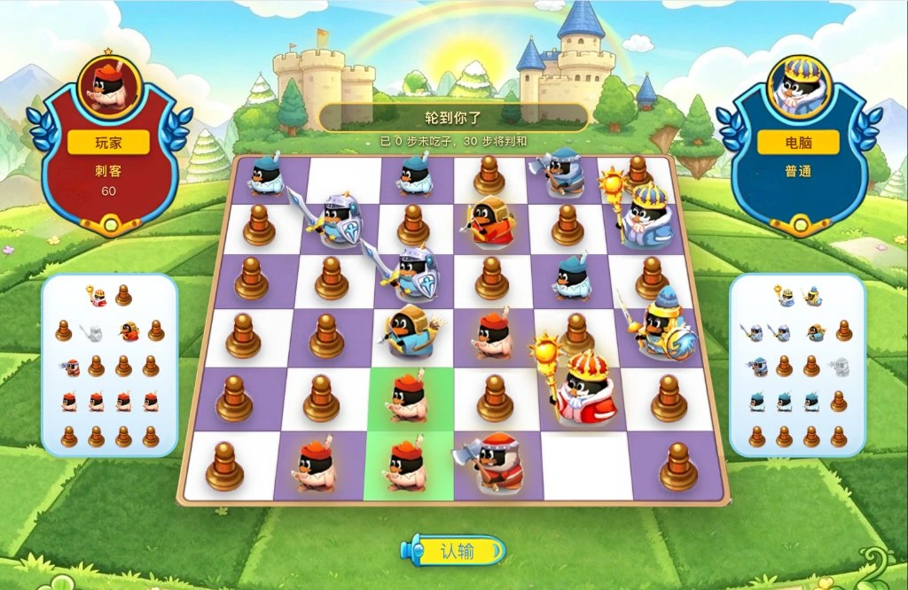

# 皇家战棋 · Web

2018 年停服的 QQ 宠物内置小游戏《皇家战棋》的网页复刻版。

> **非官方同人复刻**：与腾讯及其关联公司没有任何关系，不代表腾讯，也未获其授权。
> 代码以 MIT 发布，美术素材的版权归原作者与相应权利人所有 —— 详见 [`NOTICE`](NOTICE)。

**线上直接玩：<https://raylic.github.io/battlechess-web/>**
桌面或手机浏览器打开即可，无需安装、无需登录；也可以「添加到主屏」当作 App 用（PWA，横屏）。

---

## 游戏介绍

6×6 的暗棋：36 个格子开局全部背面朝上，翻之前**谁也不知道是哪一方的**。轮到你可以翻一张
（哪怕是对方的子），或者把自己已翻开的棋子走一格、吃掉等级不高于自己的敌子。
国王、将军、骑士、弓箭手、禁卫军、刺客 —— 等级越低越强，**刺客能吃国王，国王吃不了刺客**。

现在支持三种玩法：

| 玩法 | 说明 |
|---|---|
| **单机 vs 电脑** | 点「本地对战」，浏览器里直接跑，不联网 |
| **P2P 联机** | 点「联网对战」建房，把链接发给朋友（**需要自己找小伙伴**，没有匹配大厅）；房号就是房间种子，对面点开即进 |
| **热座 / 双窗口** | 一台机器两个人轮流下（`?mode=hotseat`），或开两个窗口对下（`?mode=dual`） |

技术上是一个纯前端项目：没有服务端、没有账号、没有数据库；联机是浏览器之间的点对点
（WebRTC），积分存在你自己的浏览器里（`localStorage`），换个设备就是从 0 开始。

---

## 本项目做了什么

### 1. 老素材高清化：AI 超分 + 无损压缩

原作是一套 2018 年的低分辨率贴图，直接放大到现在的屏幕上就是一团糊。所以素材做了三步：

1. **AI 超分**：先用超分模型把原图放大重采样，补回边缘和渐变
2. **手工清整**：裁掉原图里的登录/匹配界面残留，抹掉纪念文字，把精灵图切成单张
3. **无损 WebP**：手绘渐变 + 精灵图用 PNG 的 DEFLATE 压不动，换 WebP 无损重编码再省 14~35%
   （`scripts/to-webp.py` 会逐像素校验，解码后不一致就不换）

结果：**全部美术素材 15 个文件、共 961 KB**，整个站点打出来 **1.32 MB**。

| 项 | 体积 |
|---|---|
| 全部素材（`public/assets`，15 个文件） | 961 KB |
| 主包（JS + CSS，gzip） | ≈ 92 KB |
| 联机专用的 peerjs（gzip，只在进联机时加载） | 25 KB |
| 整个 `dist`（素材 + 代码 + 图标 + Service Worker） | 1.32 MB |

> 素材是「按需加载」的：单机玩家不会下载联机那个 chunk；棋盘棋子用一张精灵图，
> 名牌上的圆形头像甚至是**运行时**从精灵图里裁的（`src/game/plate.ts`），没有额外的头像图片。

### 2. 内置电脑

电脑是纯前端的，不联网、不调 API。默认档是 **PIMC 搜索**（Perfect Information Monte Carlo）：
对每一种"暗子可能是什么"的推断采样若干局面，每个局面用带剪枝的搜索走到底，再投票选一步。
另外还有一档"一步贪心"（最弱，用来对照）和一套手写卷积的神经网络（可选，不依赖任何推理框架）。

关键点是**公平**：电脑只拿得到它自己那一侧的视图（`viewFor(state, side)`），
它和你一样不知道没翻开的子是谁的 —— 这不是"作弊 AI"。

细节（三档强度、安全闸、循环惩罚、认输判断、训练数据怎么生成）见仓库里的 `src/core/search.ts` 与 `AGENTS.md`。

### 3. P2P 联机

点「联网对战」→ 建房 → 把邀请链接发给朋友 → 对面点开就能下。没有服务器存对局：

- **信令**只用来交换握手信息（PeerJS 公共云），之后数据走浏览器之间的 WebRTC DataChannel
- **权威只有一份**：棋局状态跑在**房主**的标签页里，对方拿到的是按视角投影后的视图
  —— 暗棋信息永远不会离开本机，改前端也看不到对面的子
- **房号 = 房间种子**：`battlechess-1234`，所以邀请链接可以口算、可以手输
- **我方永远在左**，颜色由种子派生，双方看到的是同一盘棋的两个视角
- **跨网络**：两端都有公网 IPv6 时直连即可；否则需要 TURN 中继（自备凭据填 `VITE_TURN_*`，
  凭据端点的实现见 `workers/turn-credentials.js`）。同一个 WiFi 下一定通。

### 4. 棋盘两侧的剩余子统计

棋盘左右各有一条面板，按等级列出一方还剩哪些子（5 行 × 各等级个数，共 18 个格位），
三种状态一眼可辨：**存活**（还没被吃，已在棋盘上）、**没翻起**（还扣着）、**被吃**（没了）。

它只依赖**双方都能看到的公开信息**推导，所以不会泄露暗子 —— 这不是记牌器，
是"我这一方还剩什么火力"的清单，也是原作里最容易忽略、但对判断局面最关键的那块 UI。

---

## 致谢

- **[MemoryD/BattleChess](https://github.com/MemoryD/BattleChess)** —— 原作（Python + pygame + twisted）。
  本项目的**全部美术素材**和**游戏规则 / 裁判逻辑**都来自这里，规则内核是逐行迁移过来的。
- **[Parti](https://github.com/glink25/Parti)** —— 一个基于 WebRTC 的联机开源项目。本项目的联机传输架构（"房主持有唯一权威 +
  只广播投影视图"、邀请链接即房间种子）是从它那里得到的启发。

---

## 声明与许可

- **非官方**：本项目是个人对一款已停服游戏的怀念与技术验证，与腾讯及其关联公司没有任何关系，
  不代表腾讯，也未获得其授权或认可。
- **代码**：以 **MIT** 协议开源，见 [`LICENSE`](LICENSE)。MIT 只覆盖源代码。
- **素材**：`public/assets/` 下的美术素材来自原作 MemoryD/BattleChess，其中角色形象涉及
  QQ 宠物 IP，版权归原作者与相应权利人所有。本项目对素材**不主张任何权利，也不作出任何授权**；
  如需使用请自行取得权利人许可。详见 [`NOTICE`](NOTICE)。
- **下架**：若权利人认为本项目侵犯其权益，请提交 issue；收到通知后会立即移除相关内容，
  无需额外条件。

声明能降低误会，但不能替代授权 —— 本项目不以任何形式授权商业使用或再分发。

---